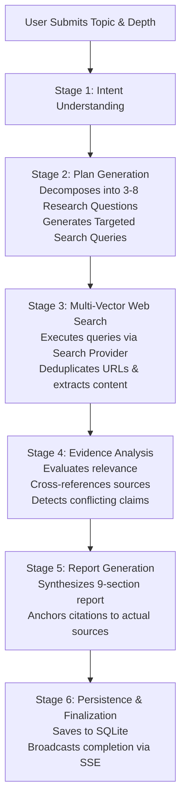

# Technical Assessment Report: ResearchPilot

## 1. Problem Statement

In contemporary professional and technical environments, conducting thorough, objective research on rapidly evolving topics requires substantial cognitive effort and time. Professionals frequently need to survey domain state-of-the-art, evaluate competing solutions, verify factual claims across independent sources, reconcile conflicting documentation, and synthesize findings into an executive-ready brief. 

Traditional search engines return disparate lists of links requiring manual inspection, while standard LLM chatbots either hallucinate outdated facts or generate ungrounded summaries devoid of traceable citations and cross-source verification.

---

## 2. Who Experiences the Problem

This friction is experienced by:
- **Software Engineers & System Architects:** Investigating emerging libraries, comparing hardware sizing requirements, or choosing between open-source models versus hosted APIs.
- **Product Managers & Technical Analysts:** Compiling competitive landscape evaluations, market trends, and technological feasibility studies.
- **Enterprise Decision-Makers:** Requiring verified risk assessments, licensing compliance evaluations, and architectural trade-off analyses prior to allocating capital and engineering bandwidth.
- **Researchers & Consultants:** Needing to produce structured research briefs with verifiable bibliographic provenance on tight deadlines.

---

## 3. Existing Manual Workflow

A standard manual research cycle typically unfolds as follows:
1. **Scope Definition:** The researcher attempts to formulate initial search queries based on their existing domain knowledge.
2. **Search Iteration:** The researcher inputs queries into search engines (Google, Bing, DuckDuckGo), opening 15–30 browser tabs.
3. **Skimming & Filtering:** The researcher manually screens pages, filtering out SEO spam, outdated blogs, and promotional marketing collateral to locate primary documentation or technical benchmarks.
4. **Note-Taking & Reconciliation:** The researcher extracts relevant paragraphs into a text editor, attempting to mentally track which source made which claim and noting where figures or claims disagree.
5. **Synthesis & Formatting:** The researcher spends 3–6 hours organizing notes into logical headings, creating comparison matrices, typing out executive summaries, and manually re-copying source URLs for references.

---

## 4. Why the Workflow is Inefficient

- **High Context-Switching Overhead:** Constant toggling between dozens of browser tabs leads to cognitive fatigue and fragmented focus.
- **Confirmation Bias:** Human researchers tend to stop searching once they find a source that confirms their initial assumption, missing conflicting empirical data or licensing nuances.
- **Ungrounded Chatbots Fall Short:** Using conversational LLMs (e.g. baseline ChatGPT) risks hallucinated benchmarks, outdated knowledge cutoffs, and fabricated URLs ("hallucinated links").
- **Duplication of Effort:** Research findings stored in ephemeral documents or chat threads are frequently lost, forcing teams to duplicate identical research weeks later.
- **Time Inefficiency:** A high-quality comparative brief typically demands 4 to 8 hours of skilled knowledge-work.

---

## 5. Why This Problem Was Selected

The research workflow presents an ideal domain for **autonomous agentic AI**:
1. **Structured Decomposition:** High-level goals naturally decompose into clear, interrogative sub-tasks.
2. **Measurable Tool Usage:** The agent must coordinate external search tools, evaluate document relevance, filter untrusted web data, and structure outputs with strict validation.
3. **High Automation ROI:** Replacing an 8-hour manual investigative cycle with a 30-to-60-second autonomous pipeline delivers immediate, measurable productivity multiplier effects.
4. **Empirical Verifiability:** Success is not subjective—it is judged on whether the report contains factual evidence, identifies actual conflicts, and points to verified external sources.

---

## 6. Proposed Solution: ResearchPilot

**ResearchPilot** is an autonomous AI agent application that executes end-to-end web research, evidence verification, and structured report synthesis. 

### Core Capabilities:
- **Intelligent Decomposition:** Analyzes research topics and dynamically formulates targeted research questions paired with specialized search queries.
- **Multi-Vector Web Retrieval:** Queries web search APIs, extracting domain provenance, page titles, and content snippets with automatic duplicate removal.
- **Evidence Cross-Referencing:** Analyzes retrieved sources to synthesize consensus findings, highlight architectural trade-offs, and surface discrepancies between sources.
- **Structured 9-Section Brief:** Produces an exhaustive Markdown report containing Executive Summary, Objective, Methodology, Key Findings, Detailed Analysis, Comparative Synthesis Matrix, Limitations, Recommendations, and Verified Source References.
- **Real-Time Transparency:** Uses Server-Sent Events (SSE) to stream live progress indicators to the user as queries are executed and sources are discovered.
- **Persistent Knowledge Base:** Stores every session, plan, source, and report in SQLite, enabling team-wide retrieval, Markdown export, and grounded follow-up Q&A.

---

## 7. Application Architecture

ResearchPilot separates concerns across three clear tiers:

```
+-------------------------------------------------------------------------+
|                              FRONTEND LAYER                             |
|  - React 18, TypeScript, Vite, Tailwind CSS                             |
|  - Real-time EventSource listener for SSE streaming                     |
|  - Markdown renderer (react-markdown + remark-gfm)                      |
|  - Source Explorer with domain filtering                                |
|  - Grounded Follow-up Q&A panel                                         |
+------------------------------------+------------------------------------+
                                     |  HTTP REST / SSE
+------------------------------------v------------------------------------+
|                               BACKEND LAYER                             |
|  FastAPI Web Service:                                                   |
|  - Lifespan & Database Table Initialization                             |
|  - Asynchronous BackgroundTasks for non-blocking agent runs             |
|  - EventManager (Pub/Sub via asyncio.Queue for multi-subscriber SSE)    |
|  - Schema Validation via Pydantic v2                                    |
+------------------------------------+------------------------------------+
                                     |
         +---------------------------+---------------------------+
         |                                                       |
+--------v-----------------------+             +-----------------v--------+
|       AGENT CORE & SERVICES    |             |      PERSISTENCE LAYER   |
| - ResearchAgent (Orchestration)|             | - SQLite Database        |
| - BaseAIService (Abstraction)  |             | - SQLAlchemy 2.0 ORM     |
|   * GeminiAIService            |             | - ResearchSession Model  |
|   * OpenAIAIService            |             | - ResearchSource Model   |
|   * MockAIService (Fallback)   |             |   (Cascade Delete)       |
| - BaseSearchService            |             +--------------------------+
|   * TavilySearchService        |
|   * MockSearchService          |
| - ReportService                |
+--------------------------------+
```

---

## 8. AI Agent Workflow

The autonomous agent executes a 6-stage sequential loop:



### Stage Breakdown:
1. **Understanding:** Validates topic scope and identifies core parameters and user instructions.
2. **Planning:** The LLM decomposes the research objective into 3 (Quick), 5 (Standard), or 7–8 (Deep) granular research questions, each with 1–2 precise web search queries.
3. **Web Search:** The agent queries the search provider for each research question. It removes duplicate URLs, extracts clean snippets, and saves discovered sources to the database in real time while publishing discovery events via SSE.
4. **Source Analysis:** The agent inspects the gathered sources against the research questions, assessing relevance scores (1–100), detecting conflicting empirical claims, and noting unverified gaps.
5. **Report Synthesis:** The agent writes the structured report adhering strictly to the 9 mandatory sections and formats citations as markdown links referencing retrieved sources.
6. **Persistence:** The full report, executive summary, and status are committed to SQLite, closing the execution loop.

---

## 9. Technology Choices and Justification

| Technology | Selection Rationale |
| :--- | :--- |
| **FastAPI** | High-performance asynchronous Python framework; native support for background tasks, Pydantic type validation, and streaming Server-Sent Events. |
| **SQLAlchemy 2.0 + SQLite** | Serverless, zero-configuration relational persistence that requires no external database container, runs cross-platform, and fully supports cascade deletions. |
| **React 18 + Vite** | Instant build times, hot module replacement, strong typing with TypeScript, and seamless component-based state management. |
| **Tailwind CSS** | Utility-first CSS allowing rapid construction of a clean, responsive SaaS UI with built-in dark/light mode class variants. |
| **Provider Abstraction** | Decouples business logic from specific vendors. Allows hot-swapping between Gemini, OpenAI, and a self-contained Mock provider with zero code changes. |
| **Server-Sent Events (SSE)** | Unidirectional streaming protocol that is significantly simpler and more resilient than WebSockets for server-to-client progress updates. |

---

## 10. Database Design

The relational schema is implemented using SQLAlchemy 2.0:

```
+------------------------------------+          +------------------------------------+
|         research_sessions          |          |          research_sources          |
+------------------------------------+          +------------------------------------+
| id: String(36) [PK, UUID]          | 1      * | id: String(36) [PK, UUID]          |
| topic: String(500)                 +----------< research_session_id: String(36)[FK]|
| instructions: Text (Nullable)      |          | title: String(500)                 |
| research_depth: String(20)         |          | url: String(1000)                  |
| status: String(30)                 |          | domain: String(255)                |
| error_message: Text (Nullable)     |          | snippet: Text                      |
| research_plan: JSON (Nullable)     |          | extracted_content: Text (Nullable) |
| report: Text (Nullable)            |          | relevance_score: Integer           |
| executive_summary: Text (Nullable) |          | relevance_explanation: Text        |
| created_at: DateTime               |          | query_used: String(500)            |
| updated_at: DateTime               |          | created_at: DateTime               |
+------------------------------------+          +------------------------------------+
```

### Relationship Constraints:
- `research_sessions.id` -> `research_sources.research_session_id` (One-to-Many).
- Foreign Key with `ondelete="CASCADE"` and `cascade="all, delete-orphan"` ensures deleting a session automatically purges all related source records from the database.

---

## 11. Security Considerations

- **Untrusted Input Sanitization:** Retrieved web content is parsed through `clean_untrusted_content()`, which uses regular expressions to neutralize prompt injection directives (e.g., `"ignore previous instructions"`, `"system prompt:"`) and truncates excessive payload sizes.
- **Client-Side Credential Isolation:** Zero API keys or tokens are delivered to or stored on the frontend. All AI and search integrations are mediated through backend server environment variables.
- **Request Boundaries & Input Validation:** Topics are capped at 500 characters, instructions at 2,000 characters, and search queries at 3 results per question to prevent resource exhaustion and denial-of-service vectors.
- **SQL Injection Prevention:** All database operations utilize SQLAlchemy parameterized ORM queries; no raw SQL string formatting is used.

---

## 12. Testing Results

The test suite was executed using Pytest within the application workspace:

```
$ PYTHONPATH=. ./venv/bin/pytest -v tests/test_backend.py
============================= test session starts ==============================
platform linux -- Python 3.15.0, pytest-9.2.0, pluggy-1.7.0 -- /home/userariii/Workspace/ResearchPilot/venv/bin/python3
rootdir: /home/userariii/Workspace/ResearchPilot
plugins: anyio-4.15.1
collected 11 items

tests/test_backend.py::test_health_check PASSED                          [  9%]
tests/test_backend.py::test_system_status PASSED                         [ 18%]
tests/test_backend.py::test_input_validation PASSED                      [ 27%]
tests/test_backend.py::test_mock_search_service PASSED                   [ 36%]
tests/test_backend.py::test_mock_ai_service_planning PASSED              [ 45%]
tests/test_backend.py::test_mock_ai_service_analysis_and_report PASSED   [ 54%]
tests/test_backend.py::test_untrusted_content_sanitizer PASSED           [ 63%]
tests/test_backend.py::test_json_extractor PASSED                        [ 72%]
tests/test_backend.py::test_full_research_api_lifecycle PASSED           [ 81%]
tests/test_backend.py::test_agent_workflow_and_export PASSED             [ 90%]
tests/test_backend.py::test_database_persistence_across_restarts PASSED  [100%]

============================== 11 passed in 6.57s ==============================
```

### End-to-End Verification:
- **Full Workflow Execution:** Autonomous agent executed on topic *"Compare state of the art open source LLMs for enterprise"*, successfully generating a plan, gathering 14 deduplicated sources, analyzing evidence, compiling an executive brief, and committing to SQLite.
- **Markdown Export:** Verified `GET /api/research/{id}/export` downloads standalone markdown with YAML metadata.
- **Restart Persistence:** Confirmed that disposing engine pools and reloading data simulates application reboot with 100% data integrity.
- **Frontend Production Build:** Verified `tsc && vite build` compiles cleanly into `frontend/dist/` and is served directly by FastAPI.

---

## 13. Limitations and Future Improvements

### Current Limitations:
1. **Search Quotas:** Third-party search APIs (Tavily) enforce strict monthly rate limits. High-volume testing relies on the included mock fallback service.
2. **Text-Only Content Extraction:** Current content parsing evaluates web snippets and text extracts; it does not render complex client-side JavaScript Single Page Applications during web search.
3. **In-Memory SSE Queues:** The SSE event pub/sub is managed via Python `asyncio.Queue` in memory, which is ideal for single-instance deployments but would require a Redis Pub/Sub layer for distributed multi-worker clustering.

### Future Roadmap:
- **Headless Browser Crawler:** Integrate Playwright or Browserbase to render dynamic JavaScript pages and extract tables from PDF whitepapers.
- **Multi-Agent Debate:** Implement a multi-agent critique loop where an independent "Critic Agent" reviews drafted findings and requests additional targeted searches before finalizing the report.
- **Vector Embedding Search:** Store retrieved text in a local Chroma or SQLite-vss vector store for semantic retrieval during follow-up Q&A sessions.
- **Direct PDF Generation:** Add server-side headless Chromium PDF rendering with custom typography and cover page templates.

